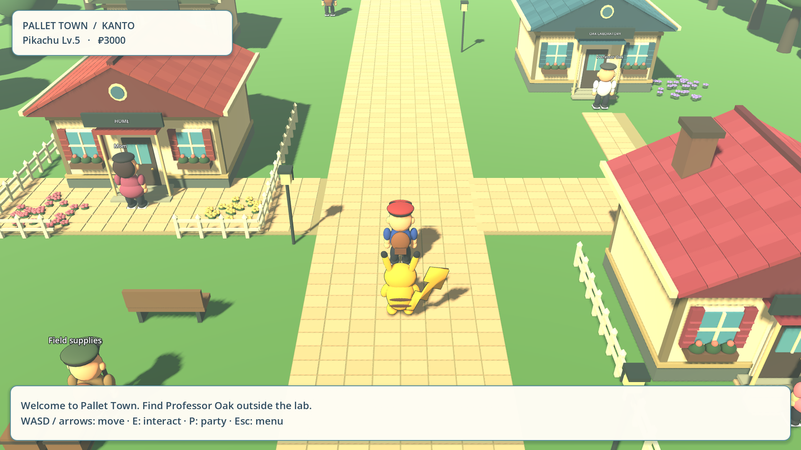
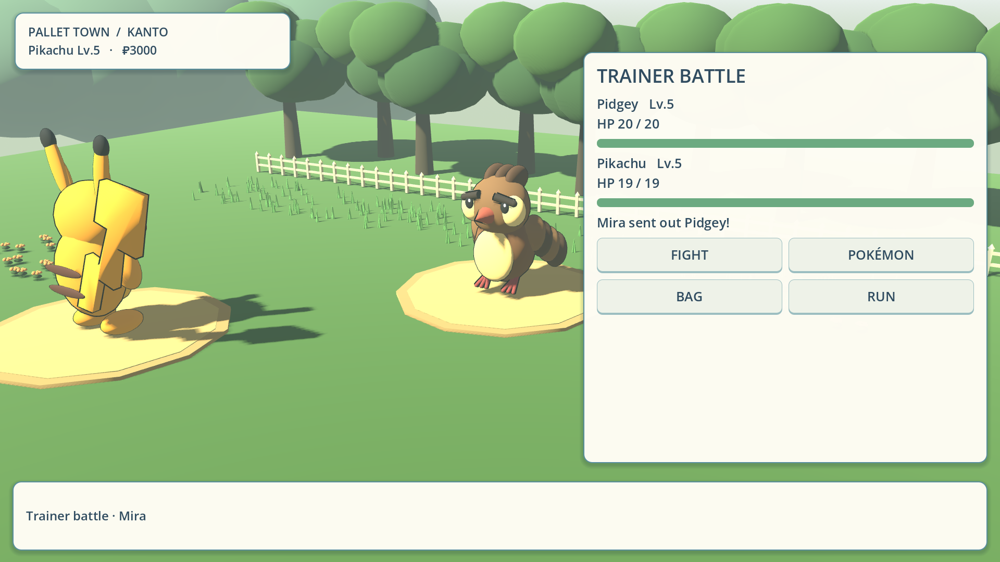
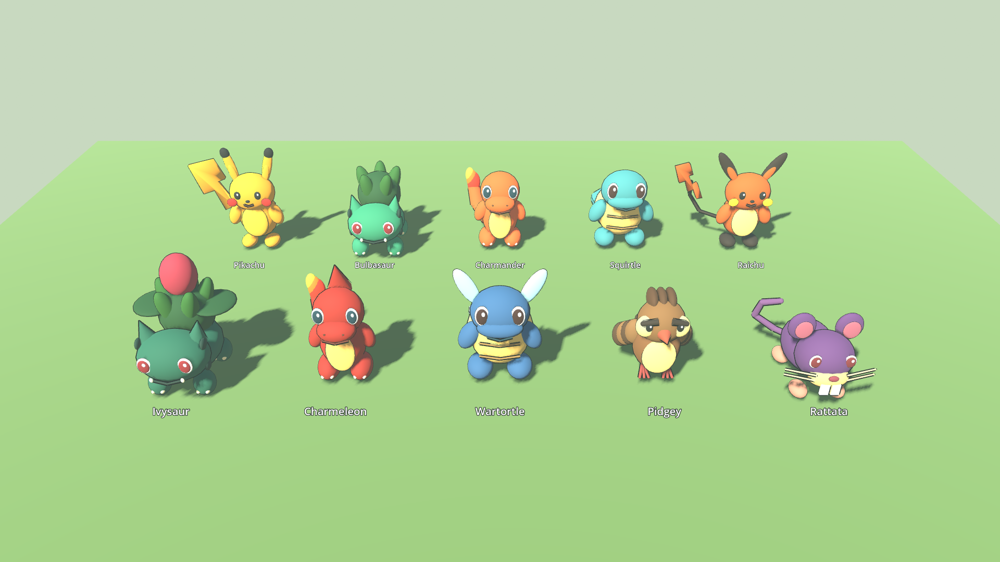

# Download Poke Journey — graphics preview 0.2

- **[Download Windows build ZIP](https://github.com/Rashedft/Test-projects/raw/refs/heads/main/downloads/PokeJourney-0.2-Windows.zip)**
- [Download Godot source ZIP](https://github.com/Rashedft/Test-projects/raw/refs/heads/main/downloads/PokeJourney-0.2-Source.zip)
- [SHA-256 checksums](PokeJourney-0.2-SHA256SUMS.txt)

Extract the Windows ZIP, open the PokeJourney folder, then double-click **PokeJourney.exe**. No Godot installation is needed to play. If GitHub opens a file page, use **Download raw file**.

For graphics testing, press **Esc → Model viewer · graphics preview**. It shows all ten current models without changing your party or save. Use the mouse wheel to adjust the exploration camera. Existing saves retain the same slot location/schema; the loader finds nearby safe ground if new scenery occupies the saved position.

This is an early opening with original development artwork targeting an X/Y-inspired direction. It is not final graphical fidelity or a complete three-region adventure. Native Windows launch of 0.2 and target-hardware FPS are unverified. See PLAY.txt and the project testing/progress documentation.

## Screenshots

These are real 1920×1080 frames from this build, not concept art.

[Open model viewer screenshot](screenshots/PokeJourney-0.2-model-25.png) · [Open move effect screenshot](screenshots/PokeJourney-0.2-battle-effects.png)

## Previous build

[Windows 0.1](https://github.com/Rashedft/Test-projects/raw/refs/heads/main/downloads/PokeJourney-0.1-Windows.zip) · [Source 0.1](https://github.com/Rashedft/Test-projects/raw/refs/heads/main/downloads/PokeJourney-0.1-Source.zip)

The baseline remains preserved. Binary ZIPs are stored in this directory to provide downloads without requiring GitHub release API access. Source ZIPs exclude the download directory to avoid recursively archiving previous builds.
